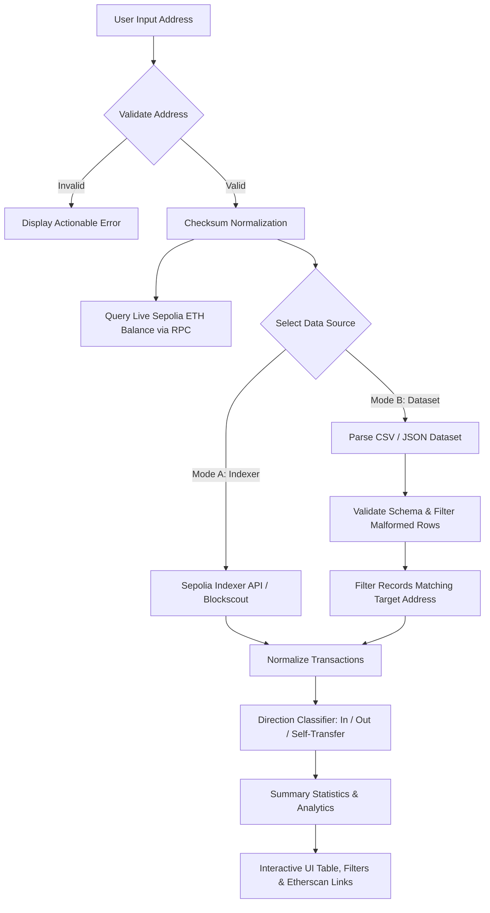

# Blockchain Wallet Activity Assistant

> **Ethereum Sepolia Testnet Explorer, Address Validator & Activity Analyzer**  
> Built for Blockchain Practical Examination using **React**, **TypeScript**, **Vite**, and **ethers.js v6**.

---

## 🚀 Overview

The **Blockchain Wallet Activity Assistant** is a production-grade decentralized application designed to inspect, validate, and analyze Ethereum wallet transaction activity on the **Sepolia Testnet**.

### Key Highlights
- **Verified Sepolia JSON-RPC Connection**: Connects to Sepolia RPC endpoints using `ethers.js v6`, strictly validating **Chain ID `11155111`**, measuring latency, and displaying block height.
- **EIP-55 Address Validation**: Robust validation using `ethers.isAddress()` and normalization with `ethers.getAddress()`. Rejects invalid lengths, non-hex characters, and checksum errors prior to making requests.
- **Dual-Mode Transaction History Adapter**:
  - **Mode A (Live Explorer/Indexer API)**: Retrieves real-time testnet transactions via Blockscout Sepolia / Etherscan Sepolia APIs with pagination, rate limit, and error handling.
  - **Mode B (Supplied / Uploaded Dataset)**: Parses offline JSON and CSV transaction datasets, validates fields, detects and isolates malformed records with row-by-row error reports, and filters transactions by wallet address.
- **Transaction Direction Classifier**: Strictly categorizes transactions relative to the queried wallet:
  - `INCOMING` (recipient matches wallet)
  - `OUTGOING` (sender matches wallet)
  - `SELF_TRANSFER` (sender & recipient match wallet — *accurately counted once without double-counting*)
  - Safe handling of **Contract Creation** (null recipient address).
- **Live Wallet Balance**: Queries native Sepolia ETH balance in real time via JSON-RPC.
- **Modern Dark-Mode UI**: Glassmorphic panels, responsive transaction table, search, direction filters, sort controls, and direct links to Sepolia Etherscan (`/tx/{hash}` and `/block/{number}`).

---

## 🛠️ Architecture & Data Flow



### Why Can't RPC Alone Retrieve Arbitrary Wallet History?
Standard Ethereum JSON-RPC nodes (`geth`, `nethermind`, `besu`) are optimized for state execution and consensus, not arbitrary historical address indexing. Methods like `eth_getTransactionByHash` or `eth_getBlockByNumber` work per block or tx hash, but a standard node does not maintain a reverse index of transactions for an arbitrary address (`getTransactionsByAddress` does not exist in standard JSON-RPC without specialized archive/tracing plugins). 

Therefore, production blockchain systems use **Indexers** (such as Blockscout, Etherscan, The Graph, or local indexed databases) or **Historical Datasets**, both of which are fully demonstrated in this application.

---

## 📦 Installation & Quickstart

### Prerequisites
- Node.js `v18+` (tested on Node `v24`)
- npm `v9+`

### 1. Clone & Install Dependencies
```bash
git clone <repository-url>
cd Blockchain-Data-Assistant-System
npm install
```

### 2. Environment Configuration
Create a `.env` file based on `.env.example`:
```bash
cp .env.example .env
```

Example `.env` configuration:
```env
# Ethereum Sepolia JSON-RPC Endpoint
VITE_SEPOLIA_RPC_URL=https://ethereum-sepolia-rpc.publicnode.com

# Explorer / Indexer API (Blockscout Sepolia is free and requires no key)
VITE_EXPLORER_API_URL=https://eth-sepolia.blockscout.com/api

# Optional Etherscan API key (Blockscout works out-of-the-box without keys)
VITE_ETHERSCAN_API_KEY=
```

### 3. Run Development Server
```bash
npm run dev
```
Open your browser at `http://localhost:5173`.

### 4. Run Test Suite
To run all 26 automated unit and integration tests:
```bash
npm run test
```

### 5. Production Build
```bash
npm run build
```

---

## 🧪 Testing Coverage

The test suite (`src/services/__tests__/services.test.ts`) verifies:
1. **Wallet Address Validation**:
   - Checksummed vs lowercase normalization.
   - Rejection of empty, blank, prefix-missing (`0x`), incorrect length, and invalid hex characters.
   - Detection of modified checksum capitalization.
2. **Direction Classification**:
   - `INCOMING` transfers.
   - `OUTGOING` transfers.
   - `SELF_TRANSFER` (tested to ensure no double-counting in net calculation).
   - `UNKNOWN` direction for irrelevant records.
3. **Normalization & Edge Cases**:
   - Smart Contract Deployment where `to` is `null` or empty string.
   - Precise Wei-to-ETH formatting using `ethers.formatEther`.
   - Handling missing fields without throwing exceptions.
4. **Dataset Parsing & Error Reporting**:
   - 32-byte (66-char) transaction hash validation.
   - CSV and JSON parsing.
   - Row-by-row malformed row detection and reporting.
   - Address filtering.
5. **Network Validation**:
   - Sepolia Chain ID verification (`11155111`).
   - Timeout and invalid URL handling.
6. **Indexer Error Resilience**:
   - Rate limit handling (`Max rate limit reached`).
   - Empty history handling (`No transactions found`).
   - HTTP failure handling (`503 Service Unavailable`).

---

## 📋 Demonstration Walkthrough (for Examination)

1. **Sepolia Network Verification**:
   - Observe the top status indicator: `Sepolia (11155111) • Block #... • Latency ms`.
   - Click **RPC Config** to switch or test custom RPC endpoints with strict Chain ID verification.
2. **Address Validation**:
   - Click the preset selector and select **Sample Exam Wallet** (`0x742d35Cc6634C0532925a3b844Bc454e4438f44e`).
   - Click **Validate Address**: note checksum normalization and live Sepolia ETH balance retrieval.
   - Test an invalid address (e.g., `0x123`) to observe actionable error messaging.
3. **Mode A — Live Indexer**:
   - Keep **Mode A** selected and click **Fetch Activity**.
   - Review live confirmed Sepolia transactions with direct Sepolia Etherscan links.
4. **Mode B — Supplied Dataset & Malformed Row Detection**:
   - Switch to **Mode B — Supplied / Uploaded Dataset**.
   - Notice the bundled sample records showcasing:
     - Faucet inflow (`INCOMING`)
     - Peer payment (`OUTGOING`)
     - Zero-value nonce ping (`SELF_TRANSFER` — single counted)
     - Smart Contract Creation (`Recipient: Contract Creation`)
     - Reverted transaction (`Status: Failed`)
   - Click **Upload CSV / JSON** to import a custom file. If any rows have malformed addresses or invalid hashes, an interactive inspection modal displays the exact row numbers and validation failure reasons.
5. **Filtering & Analytics**:
   - Toggle direction tabs: `All`, `Incoming`, `Outgoing`, `Self-Transfer`.
   - Search by transaction hash or counterpart address.
   - Sort by block number or transaction amount.
