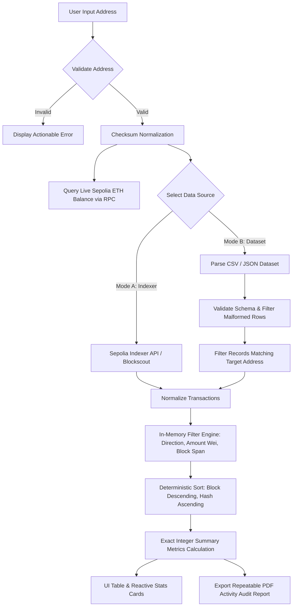

# Blockchain Wallet Activity Assistant

> **Ethereum Sepolia Testnet Explorer, Address Validator, Filter Engine & PDF Activity Audit Assistant**  
> Built for Blockchain Practical Examination using **React**, **TypeScript**, **Vite**, **ethers.js v6**, and **jsPDF**.

---

## 🚀 Overview

The **Blockchain Wallet Activity Assistant** is a production-grade decentralized application designed to inspect, validate, filter, and audit Ethereum wallet transaction activity on the **Sepolia Testnet**.

### Key Highlights
- **Verified Sepolia JSON-RPC Connection**: Connects to Sepolia RPC endpoints using `ethers.js v6`, strictly validating **Chain ID `11155111`**, measuring latency, and displaying block height.
- **EIP-55 Address Validation**: Robust validation using `ethers.isAddress()` and normalization with `ethers.getAddress()`. Rejects invalid lengths, non-hex characters, and checksum errors prior to making requests.
- **Dual-Mode Transaction History Adapter**:
  - **Mode A (Live Explorer/Indexer API)**: Retrieves real-time testnet transactions via Blockscout Sepolia / Etherscan Sepolia APIs with pagination, rate limit, and error handling.
  - **Mode B (Supplied / Uploaded Dataset)**: Parses offline JSON and CSV transaction datasets, validates fields, detects and isolates malformed records with row-by-row error reports, and filters transactions by wallet address.
- **Direction Classifier & Single-Count Rules**: Strictly categorizes transactions relative to the queried wallet:
  - `INCOMING` (recipient matches wallet)
  - `OUTGOING` (sender matches wallet)
  - `SELF_TRANSFER` (sender & recipient match wallet — *accurately counted once without double-counting*)
  - Safe handling of **Contract Creation** (null recipient address).
- **Exact Integer Arithmetic Filtering**:
  - **Direction Filter**: `All`, `Incoming Only`, `Outgoing Only`, `Self-Transfers Only` (excludes `UNKNOWN` direction when directional filter is active).
  - **Amount Range**: Min & Max ETH range using exact **BigInt Wei integer arithmetic** (`parseEther`) to eliminate floating-point rounding errors. Inclusive boundaries applied consistently.
  - **Block Range**: Min & Max block numbers with inclusive boundary checking and non-negative integer validation.
  - **Zero Blockchain Request Overhead**: Filtering operates strictly in-memory on retrieved datasets without triggering redundant network calls.
  - **Validation & Recovery**: Clear error messages for `Min > Max` or negative inputs, with **Apply Filters**, **Reset Filters**, and **Clear Results** controls.
- **Repeatable PDF Audit Report Generation (`jsPDF` + `jspdf-autotable`)**:
  - Generates multi-page, publication-grade PDF audit documents.
  - Preserves user query text and audit intent exactly as entered.
  - Contains applied filter statuses (active vs inactive), exact summary metrics, and full transaction tables with repeated headers and `Page X of Y` footers.
  - Deterministically sorted by block number descending, then by transaction hash ascending.
  - Includes full data-source transparency and financial disclaimer.
- **Live Wallet Balance**: Queries native Sepolia ETH balance in real time via JSON-RPC.
- **Modern Dark-Mode UI**: Glassmorphic panels, responsive transaction table, search, direction filters, sort controls, and direct links to Sepolia Etherscan (`/tx/{hash}` and `/block/{number}`).

---

## 🛠️ Architecture & Data Flow



### Why Can't RPC Alone Retrieve Arbitrary Wallet History?
Standard Ethereum JSON-RPC nodes (`geth`, `nethermind`, `besu`) are optimized for state execution and consensus, not arbitrary historical address indexing. Methods like `eth_getTransactionByHash` or `eth_getBlockByNumber` work per block or tx hash, but a standard node does not maintain a reverse index of transactions for an arbitrary address (`getTransactionsByAddress` does not exist in standard JSON-RPC without specialized archive/tracing plugins). 

Therefore, production blockchain systems use **Indexers** (such as Blockscout, Etherscan, The Graph, or local indexed databases) or **Historical Datasets**, both of which are fully demonstrated in this application.

---

## 📦 Installation & Quickstart

### Prerequisites
- Node.js `v18+` (tested on Node `v24`)
- npm `v9+`

### 1. Clone & Install Dependencies
```bash
git clone <repository-url>
cd Blockchain-Data-Assistant-System
npm install
```

### 2. Environment Configuration
Create a `.env` file based on `.env.example`:
```bash
cp .env.example .env
```

Example `.env` configuration:
```env
# Ethereum Sepolia JSON-RPC Endpoint
VITE_SEPOLIA_RPC_URL=https://ethereum-sepolia-rpc.publicnode.com

# Explorer / Indexer API (Blockscout Sepolia is free and requires no key)
VITE_EXPLORER_API_URL=https://eth-sepolia.blockscout.com/api

# Optional Etherscan API key (Blockscout works out-of-the-box without keys)
VITE_ETHERSCAN_API_KEY=
```

### 3. Run Development Server
```bash
npm run dev
```
Open your browser at `http://localhost:5173`.

### 4. Run Test Suite
To run all 45 automated unit and integration tests:
```bash
npm run test
```

### 5. Production Build
```bash
npm run build
```

---

## 🧪 Testing Coverage (45 Passing Tests)

The test suites (`src/services/__tests__/services.test.ts` and `src/services/__tests__/filtersAndPdf.test.ts`) verify:
1. **Wallet Address Validation**:
   - Checksummed vs lowercase normalization.
   - Rejection of empty, blank, prefix-missing (`0x`), incorrect length, and invalid hex characters.
   - Detection of modified checksum capitalization.
2. **Direction Classification & Filtering**:
   - `INCOMING` transfers only.
   - `OUTGOING` transfers only.
   - `SELF_TRANSFER` (single-counted without double-counting).
   - Exclusion of `UNKNOWN` direction when directional filter is active.
3. **Amount Range with Exact BigInt Integer Arithmetic**:
   - Parsing ETH to exact integer Wei (`parseEther`).
   - Inclusive amount boundary tests (`txWei >= minWei && txWei <= maxWei`).
   - Large integer Wei values (e.g. `50.123456789 ETH`).
   - Range validation errors (`Min > Max`, negative values).
4. **Block Range Tests**:
   - Inclusive block boundary tests (`tx.blockNumber >= minBlock && tx.blockNumber <= maxBlock`).
   - Exclusion of records with missing or zero block numbers when block filter is active.
   - Range validation errors (`Min > Max`, negative values).
5. **Combined Filters & Zero-Result Handling**:
   - Simultaneous operation of all filters without mutating original datasets.
   - Zero matching records handling with clean summary outputs.
6. **Summary Calculation & Single-Count Rules**:
   - Aggregation of incoming and outgoing values using exact integer BigInt addition.
   - Verified that self-transfers never inflate incoming or outgoing sums.
7. **Deterministic Sorting**:
   - Block number descending, then transaction hash ascending.
8. **Repeatable PDF Report Generation**:
   - Generation of valid PDF documents with matching records.
   - Handling of zero matching records with clear empty-state notifications.
   - Preservation of user query text and data-source transparency disclaimers.

---

## 📋 Demonstration Guide (Practical Examination)

### Demonstration 1: Wallet Validation & RPC Connectivity
1. Verify the network status badge: `Sepolia (11155111) • Block #... • Latency ms`.
2. Click **RPC Config** to view preset Sepolia endpoints or test custom endpoints.
3. Choose **Sample Exam Wallet** (`0x742d35Cc6634C0532925a3b844Bc454e4438f44e`) and click **Validate Address**.
4. Observe checksum normalization and live native Sepolia ETH balance query.

### Demonstration 2: Dual-Mode Data Retrieval
1. **Mode A (Live Indexer)**: Click **Fetch Activity** to query live Sepolia transactions from Blockscout/Etherscan.
2. **Mode B (Supplied Dataset)**: Select **Mode B** and click **Fetch Activity** to load the bundled sample dataset. Notice that transactions are filtered specifically for the queried wallet.

### Demonstration 3: Multi-Parameter Filtering & Range Validation
1. Enter an audit intent in **Audit Query Intent** (e.g. `Audit Q3 faucet distributions and collaborator transfers`).
2. Select **Direction**: `Incoming Only` and click **Apply Filters**. Notice that outgoing and self-transfer records are excluded, and summary cards update reactively.
3. Set **Min ETH**: `0.5` and **Max ETH**: `1.0`. Click **Apply Filters**. Notice that only transactions within this inclusive range are displayed.
4. Test validation: Enter **Min ETH**: `5.0` and **Max ETH**: `1.0`. Click **Apply Filters** to observe the validation error banner: `"Minimum ETH amount cannot exceed maximum amount."`
5. Click **Reset Filters** to restore original query settings without re-fetching from the network.

### Demonstration 4: Repeatable PDF Report Generation
1. Configure any desired filter (or keep all records).
2. Click **Export PDF Report**.
3. Inspect the downloaded PDF:
   - Header with generation date, network (`Ethereum Sepolia`), chain ID (`11155111`), queried address, and data source.
   - The user's query text rendered under **User Query & Audit Intent**.
   - The **Filter Configuration** table showing active vs inactive filters.
   - **Summary Metrics** computed using exact integer BigInt arithmetic.
   - The **Matching Transaction Records** table with repeated headers on multiple pages.
   - Page footers (`Page X of Y`) and the **Data Source Transparency Disclaimer**.
